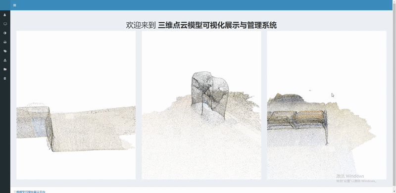
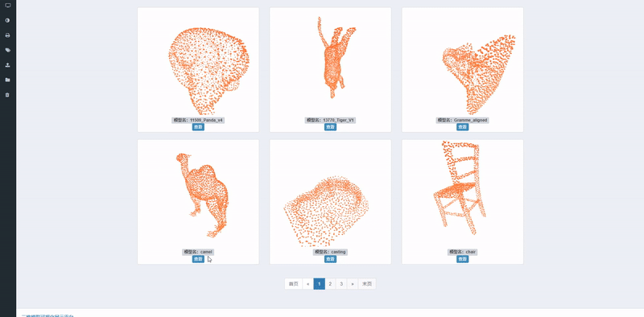
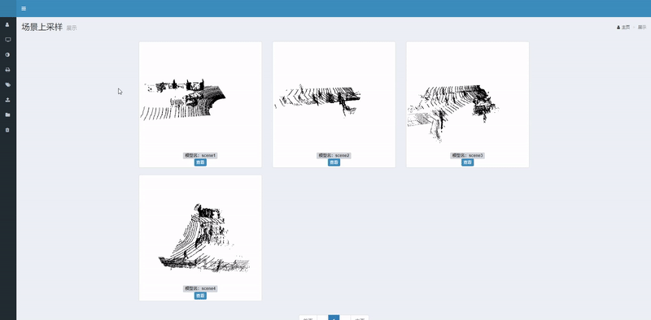
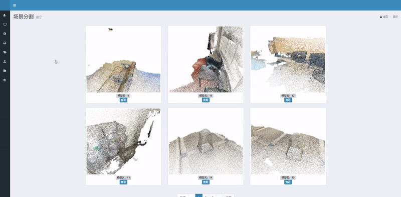
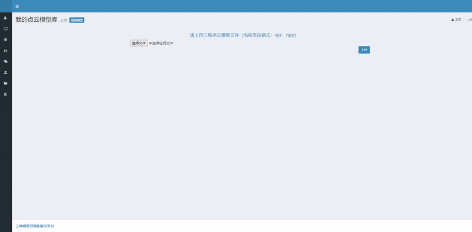
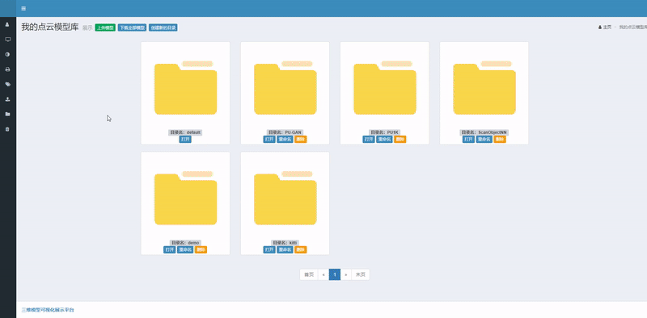

# PCVisAPP

Languages: English | [Chinese](./README.zh-CN.md)

## 1. Project Introduction

PCVisAPP is a demonstration system for graduation-design research work, focusing on 3D point cloud upsampling and semantic segmentation. The system includes algorithm-processing demos for 3D models, 3D model upload and management, and web-based 3D model rendering controls.

This project is open sourced for students and researchers working on 3D computer vision who need a practical visualization and presentation system. Stars, forks, pull requests, and issues are welcome to help improve the project :-)

### 1.1 Dependencies

- Frontend: jQuery, Bootstrap 3, Three.js, Font Awesome
- Backend: Django
- Other: TensorFlow

### 1.2 Features

#### 1.2.1 Demo Module

This module demonstrates algorithm processing for 3D models, including point cloud upsampling, scene upsampling, segmentation dataset visualization, and scene segmentation. Each demo usually displays the original model, generated model, and ground-truth model.

#### 1.2.2 Model Management Module

This module is a lightweight file management system for 3D point cloud models. It supports creating directories, renaming directories, deleting directories, uploading models, viewing models, downloading models, moving models, deleting models, upsampling models, and managing the recycle bin.

#### 1.2.3 Model Rendering Module

This module provides web-based rendering controls for 3D models. Users can adjust rendering parameters to achieve the desired visual effect.

## 2. Environment Setup

1. Create and activate the `pcvisapp` conda environment. The following commands assume that you are already in the project root directory, `PCVisAPP`.

    ```shell
    conda create -n pcvisapp python=3.6 --yes
    conda activate pcvisapp
    ```

2. Install Python package dependencies.

    ```shell
    pip install -r requirements.txt
    ```

3. Compile the TensorFlow operators. If installing `tensorflow-gpu` is inconvenient in your environment, or if no GPU is available, you can skip this step. To keep the system running without this operator, comment out `from PointCloudManage.upsample_op.model import Model` in `PointCloudManage/utils.py` and adjust the `upsample_points` method accordingly.

    The purpose of `upsample_points` is to call a TensorFlow-based neural network to upsample 3D point cloud models. You can also replace the implementation with your own point cloud processing algorithm.

    ```shell
    cd PointCloudManage/upsample_op/tf_ops
    sh compile_ops.sh
    ```

4. Download the [reference test data](https://drive.google.com/file/d/1hb78WSrDIp2GRBp63lhRISAsDxK-y7_o/view?usp=sharing). This step is optional. You can extract the data and overwrite the `static` directory.

    - [Download from Google Drive](https://drive.google.com/file/d/1hb78WSrDIp2GRBp63lhRISAsDxK-y7_o/view?usp=sharing)
    - [Download from Baidu Netdisk, extraction code: i353](https://pan.baidu.com/s/1vbjg-n5-DBMyE-55gNg6jw)

5. Run the system. Before running it, update `CFG.gpu` in `PointCloudManage/upsample_op/config.py` to an available GPU.

    ```shell
    python manage.py runserver 0.0.0.0:<ip_port>
    ```

## 3. Screenshots and Demos

### 3.1 Home Page



### 3.2 Demo Module

#### 3.2.1 Point Cloud Upsampling Demo



#### 3.2.2 Scene Upsampling Demo



#### 3.2.3 Segmentation Dataset Demo


#### 3.2.4 Scene Segmentation Demo



### 3.3 Model Management Module

#### 3.3.1 Model Upload



#### 3.3.2 Model Management


#### 3.3.3 Model Deletion and Recycle Bin


### 3.4 Model Rendering Module

#### 3.4.1 OBJ Rendering



#### 3.4.2 PLY Rendering


## 4. Future Work

1. User permission management system
2. Automatic rendering-page generation system

## 5. References

[[1] TensorFlow](https://www.tensorflow.org/)

[[2] jQuery](https://jquery.com/)

[[3] Bootstrap, the most popular HTML, CSS, and JS library](https://getbootstrap.com/)

[[4] Three.js - JavaScript 3D Library](https://threejs.org/)

[[5] Font Awesome, the iconic font and CSS toolkit](https://fontawesome.com/v4/)

[[6] Django - The Web Framework for Perfectionists with Deadlines](https://www.djangoproject.com/)

[[7] PU-GAN: a Point Cloud Upsampling Adversarial Network](https://github.com/liruihui/PU-GAN)

[[8] AdminLTE - Bootstrap 4 Admin Dashboard](https://github.com/ColorlibHQ/AdminLTE)
